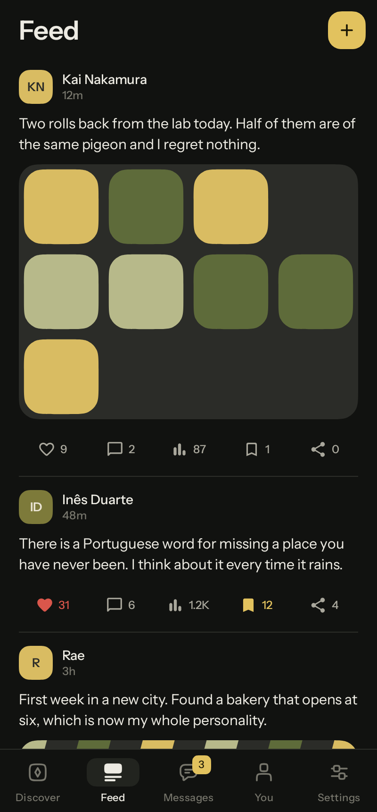
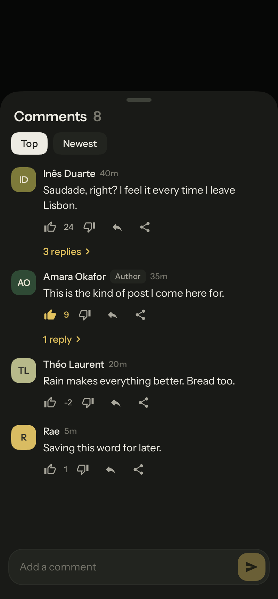
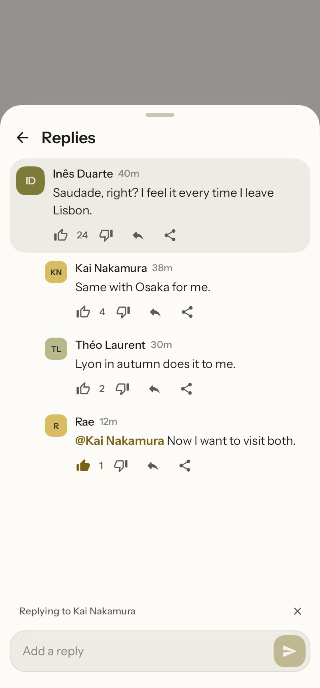
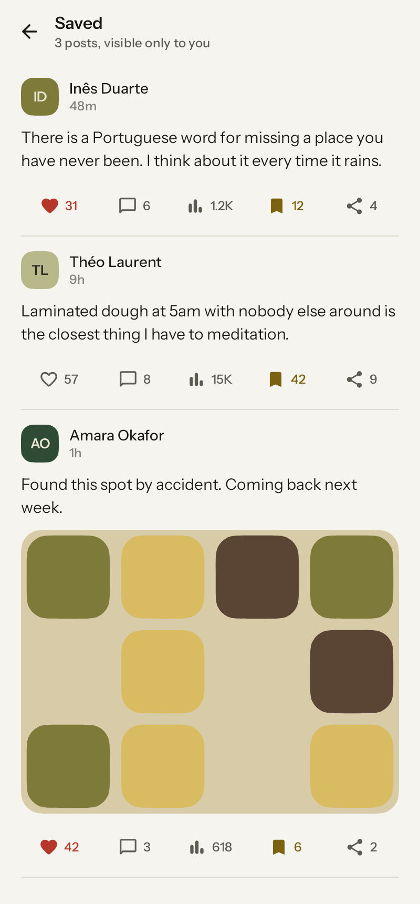
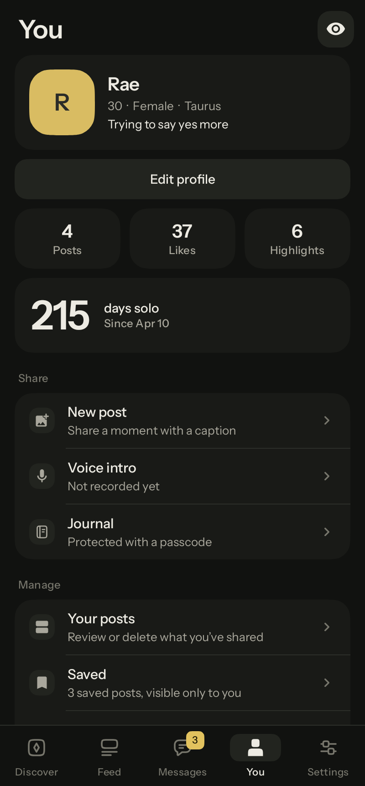

# Nearfolk

A native Android app for meeting strangers and talking at your own pace. It grew out of a solitude day counter and keeps that counter, but the product is now peer chat: discover people, follow what they post, read their profile, start a conversation, stay safe while doing it.

"Nearfolk" is a working name. It lives in `app/src/main/res/values/strings.xml` (`app_name`) and `feature/onboarding` (`onb_app_name`). The application id is `app.nearfolk`. Pick the final name and id before the first Play Store upload, because the id cannot change afterwards.

| Welcome | Discover | Feed | Comments |
| --- | --- | --- | --- |
|  |  |  |  |

| Profile | Messages | Chat | Chat request |
| --- | --- | --- | --- |
|  |  |  |  |

| Replies | Post activity | Saved | You |
| --- | --- | --- | --- |
|  |  |  |  |

| Chat composer | Journal lock |
| --- | --- |
|  |  |

## What works today

- **Onboarding**: name, gender, date of birth (18+ only), country, community guidelines, notification permission.
- **Discover**: dense member list with avatar, presence, age, gender, sign, city and a bio snippet. A filter sheet (show me, online only, countries, age range for Plus) whose button counts the filters in use, pull to refresh, and typo tolerant name search ("amra" finds "Amara").
- **Feed**: the second tab (Discover, Feed, Messages, You, Settings). One timeline of everyone's posts, newest first, drawn exactly like the posts on a profile: your own posts and those of members you can find in Discover. Blocked and deactivated members drop out at once. Tap an author to open their profile, write a post from the header. Posts that arrive while you read further down never move the list; a "New posts" pill takes you back up. Your own new post shows right away. Pull to refresh.
- **Posts**: every post, wherever it appears (feed, profiles, your posts, saved), ends in the same row of five actions that share the width equally, each with a live count: like, comment, views, save and share. Counts are compact under the post (1.2K, 15K) and read in full by screen readers. Views count each post once per app session when at least half of it is on screen, written in small batches so scrolling does not reload the list per post. The views button opens a post activity sheet with every total. Share opens the system share sheet with the post text; the share count goes up only once an app is picked (the chooser reports the choice to `PostShareReceiver`). Saving shows a short note with a way to the saved list.
- **Comments**: threads modelled on YouTube, two levels deep. The sheet lists top-level comments by Top or Newest and keeps that order while it is open, so a comment never jumps away under your finger; what you just wrote goes to the top. "3 replies" opens a replies page inside the sheet, with the comment at the top and its replies oldest first. Replying to a reply posts in the same thread and puts "@Name" in front, which opens that profile. Back leaves the replies page before it closes the sheet. Under every comment: like, the score, dislike, reply and share. Like and dislike are one up and down vote, like Reddit: a dislike takes one off the score, scores can go below zero, and voting again takes your vote back. Avatars and names open profiles, and coming back returns to the comments as they were. The post's author is marked. Replies to your comments show up in Activity and as notifications.
- **Profiles**: cover image, avatar, exact last seen time, status, day counter, details, voice intro, highlights grid with a full screen viewer, and an endless post stream with likes and comments. Report and block from the overflow menu.
- **Composer**: chat messages get one container with attachments waiting to send, the text, and a fixed action row (attach on the left, send on the right). Comments and replies get a text only box: the text and send, nothing else. The text grows up to a quarter of the space visible above the keyboard (3 to 12 lines), then scrolls inside the box. Send stays on screen, dimmed until there is something to send.
- **Attachments**: up to 10 photos, videos or GIFs per chat message, from the system photo picker or straight from the keyboard's GIF and sticker panels. Photos are re-encoded without location data; GIFs and stickers keep their animation; videos play in a full screen viewer.
- **Messages**: chats and requests (first messages from people you have not accepted yet; the message bar stays hidden until you accept, block or delete), archived threads, unread counts, typing state, delivery and read marks, day separators, grouped bubbles, long press to copy.
- **Safety**: dismissible safety notice per chat, a cap of three messages until the other person replies, report with reasons, block with confirmation (archives the thread), delete chat with confirmation, blocked members list.
- **You**: profile preview as others see it, edit identity, avatar and cover crop (pan and pinch in a squircle frame), voice intro recording, posts (with comments in place), saved posts, highlights, and an activity feed for likes, comments and replies to your comments.
- **Saved**: under You, Manage, Saved. Every post you bookmarked, the most recently saved first, with the same actions as anywhere else. Only you see the list; posts from people you block drop out of it until you unblock them. Taking a post out can be undone from the note that follows, and it returns to its old place.
- **Journal**: private or public entries with a mood, protected by a 6 digit passcode (salted PBKDF2, escalating lockout, relocks when the app goes to the background).
- **Settings**: system, light or dark theme plus a true black option, notification and haptic toggles, Plus plans, support and bug report by email, guidelines, privacy, terms, licenses, deactivate, delete account (three steps, typed confirmation), sign out.

## The network is simulated for now

There is no backend yet. `core:data` ships a local implementation of every repository plus `CommunitySimulator`, which seeds 40 sample members with posts, highlights and journals, moves people online and offline, answers your messages, sends a few first messages to new profiles, publishes a new post every few minutes while the app is open, keeps views, saves and shares on recent posts moving, votes on and answers your comments, and reacts to your posts. All of it writes to the same Room tables a real sync layer would, so screens do not know the difference. Settings says plainly that community data is a local sample, and Plus says that store billing is not connected.

Choosing the backend is the main decision for the next cycle. The seams are ready:

- Repository interfaces: `core/data/src/main/kotlin/app/nearfolk/core/data/repository/Repositories.kt`
- Local implementations to replace: `core/data/.../local/`
- Push notifications: `ChatNotifier` in `core/data/.../platform/AppVisibility.kt`, implemented in `app/.../notifications/Notifications.kt`
- Billing: `PlusRepository` (local implementation unlocks Plus on the device for testing)

## Design system

Everything visual lives in `core:designsystem`.

- **Squircles**: `SquircleShape` draws continuous curvature corners. Each corner keeps its usual circle centre, trims the arc at both ends and joins the straight edge with a cubic ramp whose first three control points sit on the edge, so curvature starts at zero instead of jumping. Smoothing defaults to 0.6. The geometry is unit tested in `SquircleGeometryTest`.
- **Where squircles are not used**: switches keep a stadium track, presence dots and the playback waveform stay simple, because those read faster in their usual shape.
- **Palette**: graphite and paper neutrals with one straw accent (hue about 46 degrees). Green is reserved for presence, red for destructive actions. No pink, purple, violet, blue or orange anywhere, including generated artwork. Chat bubbles are monochrome so long conversations stay calm.
- **Type**: Instrument Sans, variable, SIL Open Font License 1.1 (bundled with its license).
- **Popups**: menus, sheets and dialogs live in their own translucent windows, where the stretch overscroll shader and scaled or path clipped layers can sample uninitialized texture. That showed up as static when a list was flung against the edge of a popup. Every popup is wrapped in `NfPopupContent` and follows three rules: no overscroll effect, surfaces are filled with their shape (`Modifier.shapeSurface`) instead of clipping scroll content to a path, and movement is translation only. `NfBottomSheet` is our own sheet in a plain full screen window (`NfOverlayWindow`): it rests at the height of its content, can only move down, follows the finger through a list at its top, ignores leftover fling velocity and never stretches. A `BackHandler` inside a popup runs before the popup's own back handling, so a sheet with pages can step back through them. `NfMenu` fades and slides a few pixels without scaling. The date picker keeps Material's dialog with a plain rounded rectangle, which the renderer clips without a path. `BottomSheetTest` and `PopupTest` cover flings, drags, dismissal and placement.
- **Motion**: spring presets in `NfMotion`. Buttons and rows shrink slightly on press, the tab indicator and segmented thumbs glide, screens slide in, likes bounce.
- **Icons**: the four navigation icons and the journal icon are drawn for this app (`NfIcons`). Other icons come from Material Symbols (Apache 2.0).
- **Copy**: plain and functional. A Gradle task (`./gradlew verifyCopyPunctuation`) fails the build if an em dash or en dash appears in any Kotlin source or resource file.

## Architecture

Kotlin, Jetpack Compose, Hilt, Room, DataStore, Navigation (type safe routes), Paging 3, Coil. Offline first: screens observe Room through repositories; whatever talks to the network writes into Room.

```
app                     Activity, navigation, notifications, theme selection
core/model              Plain Kotlin domain types
core/common             Fuzzy search, passcode hashing, clock
core/designsystem       Theme, squircle shape, components, icons
core/ui                 Shared composables that know the domain (avatars, rows, posts, sheets)
core/database           Room entities and DAOs (schemas exported to core/database/schemas, auto migrations)
core/datastore          Typed preferences
core/data               Repositories, media storage, voice recording, local community
feature/onboarding      Welcome and profile creation
feature/discover        Member list, filters, search
feature/feed            Timeline of everyone's posts, comments
feature/profile         Public profile, highlights, posts, comments
feature/messages        Inbox, requests, archive, chat
feature/you             Your hub, editing, crop, voice intro, posts, highlights, activity
feature/journal         Journal, passcode gate, public journals
feature/settings        Settings, Plus, account lifecycle, documents
build-logic             Convention plugins shared by every module
```

## Build and test

Requirements: JDK 17 or newer and the Android SDK with platform 37.

```
./gradlew :app:assembleDebug          # debug APK
./gradlew :app:assembleRelease        # minified release APK (unsigned)
./gradlew test                        # unit, repository, screenshot and end to end tests
./gradlew :app:lintDebug              # lint across all modules
./gradlew verifyCopyPunctuation       # copy rule check
```

`AppFlowTest` runs the real app on Robolectric: it creates a profile, searches with a typo, opens a profile, sends a message and waits for the read mark, then opens the feed, comments on a post, likes and replies to a comment, opens a commenter's profile and comes back to the comments, saves a post, removes it from Saved and undoes that, shares a post and opens its author. `CommentsSheetTest` covers the sheet on its own: votes, replies, named answers, back and the text only box. `ScreenshotTest` renders the main screens in both themes and `PopupTest` captures every popup; pass `-Proborazzi.test.record=true` to write the images to `app/build/screenshots`.

Toolchain: AGP 9.5, Gradle 9.6, Kotlin 2.4, Compose BOM 2026.09, compile and target SDK 37, min SDK 29.

## Before release

- Replace `SUPPORT_EMAIL` in `app/build.gradle.kts` with a mailbox you own.
- Connect a backend and Play Billing, then remove the local sample notes in Settings and Plus.
- Have the privacy policy and terms reviewed; the in app versions describe this build only.
- Run a trademark search on the final name.
